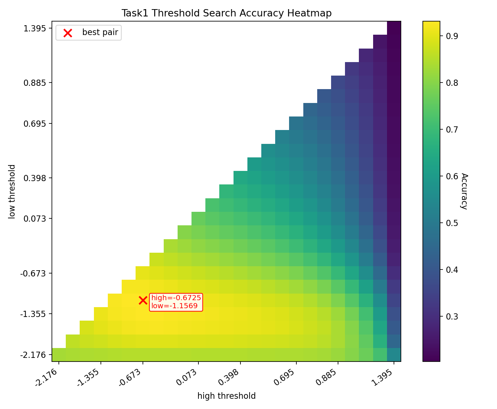
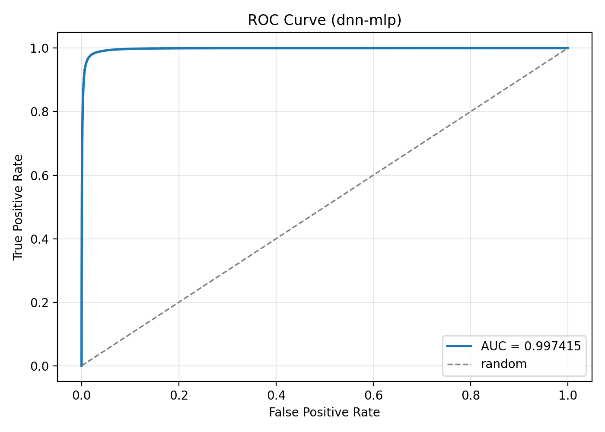

# Voice Activity Detection: from short-time features to neural models

This repository implements a complete frame-level voice activity detection (VAD) pipeline in two stages: an interpretable short-time-feature baseline and a stronger spectral-feature classifier. The code covers waveform loading, label alignment, feature extraction, model fitting, threshold selection, frame smoothing, evaluation and time-segment generation.

> The course dataset, generated predictions, experiment logs and submission packages are intentionally excluded. The reported numbers below come from the original development split and are kept only as a concise reproducibility reference.

## What is implemented

| Track | Features | Classifier | Main idea |
| --- | --- | --- | --- |
| Task 1 | Energy, zero-crossing rate, short-time spectrum, pitch | Weighted score + dual-threshold hysteresis | A lightweight and interpretable VAD baseline |
| Task 2 | FBank/MFCC, CMVN, deltas, context frames | Class-wise GMM or PyTorch MLP | Learn nonlinear speech/non-speech boundaries from spectral dynamics |

Both tracks use 16 kHz audio, 32 ms frames and an 8 ms frame shift. Development-set scores are used to select decoding thresholds; predictions are smoothed per utterance before being converted to timestamp intervals.

```text
waveform -> framing -> acoustic features -> frame scores
         -> dev threshold selection -> smoothing -> speech segments
```

## Results

Frame-level results on the original development split:

| System | Best configuration | Accuracy | F1 | AUC | EER |
| --- | --- | ---: | ---: | ---: | ---: |
| Task 1 | Energy, no window, dual thresholds | 95.12% | 97.02% | 96.64% | 8.34% |
| Task 2 / GMM | MFCC + Δ | 96.07% | 97.54% | 97.91% | 4.94% |
| Task 2 / DNN | MLP, FBank + Δ + Δ², 100 epochs | **98.54%** | **99.07%** | **99.74%** | **2.04%** |

The main empirical finding is that temporal spectral information matters: adding delta features and wider frame context consistently improves over static features, while the DNN captures the resulting nonlinear decision boundary better than the GMM.

| Task 1 threshold search | Task 2 final DNN ROC |
| --- | --- |
|  |  |

Additional retained figures are available in [`docs/assets`](docs/assets).

## Repository layout

```text
.
├── task1/                         # Short-time features and threshold VAD
├── task2/                         # Spectral features and GMM/DNN VAD
├── voice-activity-detection-sjtu-spring-2024/
│   └── vad/                       # Evaluation and label-conversion helpers
├── docs/assets/                   # Selected, anonymized result figures
├── experiment_logger.py           # Portable JSONL experiment metadata
└── requirements.txt
```

## Setup

Python 3.10 or newer is recommended.

```bash
python -m venv .venv
source .venv/bin/activate
python -m pip install -r requirements.txt
```

Place the dataset locally using this structure:

```text
voice-activity-detection-sjtu-spring-2024/vad/
├── data/
│   ├── train_label.txt
│   └── dev_label.txt
└── wavs/
    ├── train/*.wav
    ├── dev/*.wav
    └── test/*.wav
```

These paths are ignored by Git so that audio data and course-provided labels are not accidentally published.

## Run the pipelines

Run commands from the repository root.

```bash
# Task 1: tune/evaluate on dev, then predict test segments
python task1/run_dev.py
python task1/run_test.py --output task1/test_label.txt

# Task 2: train/evaluate on dev, then predict test segments
python task2/run_dev.py
python task2/run_test.py --output task2/test_label.txt
```

Task 2 reads configuration from `TASK2_*` environment variables. Common switches include:

```bash
TASK2_MODEL_TYPE=gmm \
TASK2_FEATURE_TYPE=mfcc \
TASK2_USE_DELTA=true \
TASK2_USE_DELTA_DELTA=false \
python task2/run_dev.py
```

See [`task1/README.md`](task1/README.md) and [`task2/README.md`](task2/README.md) for the files and responsibilities in each implementation.

## Evaluation protocol

- Task 1 tunes feature weights and hysteresis thresholds on the development split.
- Task 2 trains the classifier on the training split, then selects a frame-score threshold on the development split.
- Metrics are computed after concatenating all development frames: accuracy, precision, recall, F1, FAR, FRR, AUC and EER.
- The test split is used only for unlabeled segment generation.

Generated logs, plots and test labels are written to ignored paths. Experiment records normalize paths inside the repository and user home directory so local machine details are not copied into tracked artifacts.
